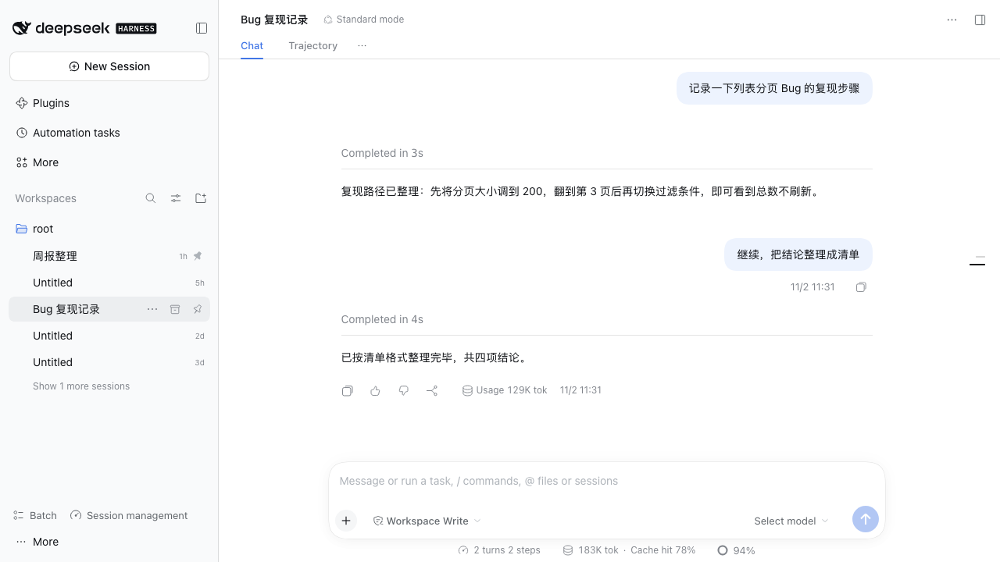
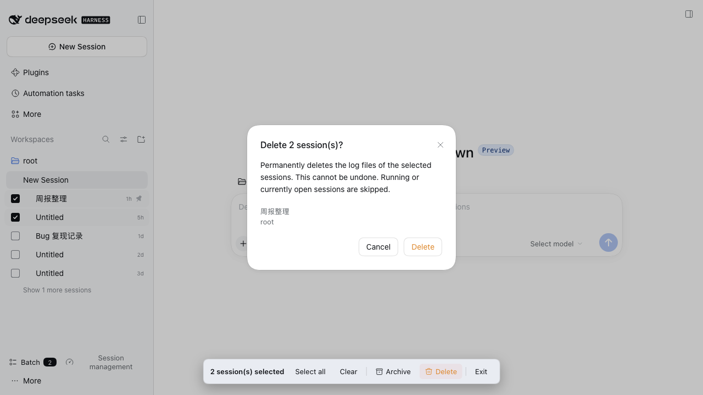
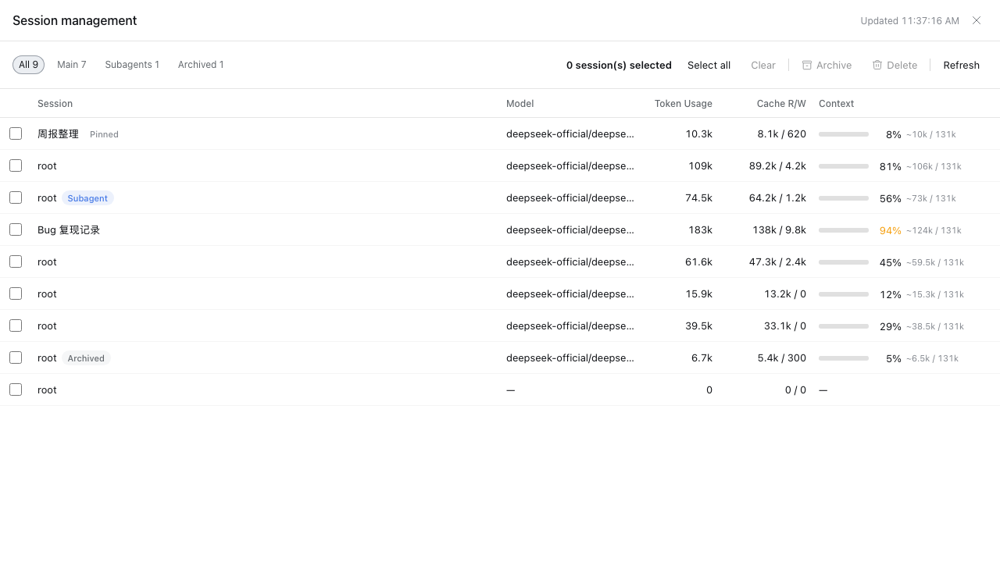
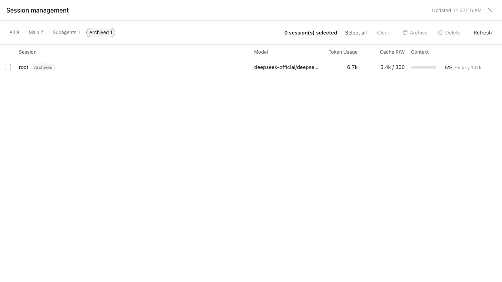
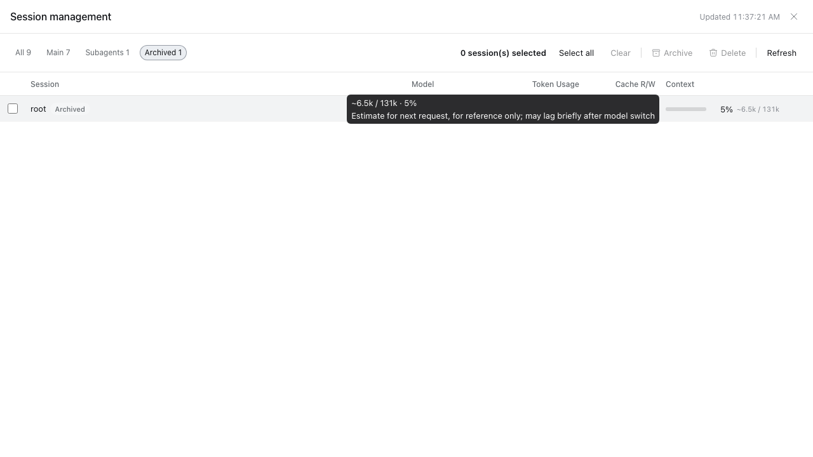

# dsh-session-batch-manager — batch session manager and session dashboard for DeepSeek Harness

English | [中文](README.zh.md)

[](https://github.com/deepseek-ai/deepseek-harness)
[](https://github.com/mars401/dsh-session-batch-manager)

## 0 Overview

Batch session management for DeepSeek Harness (DSH): multi-select sessions in the sidebar and batch **archive / unarchive / delete**, plus a full-screen **Session management** dashboard that visualizes **model, token usage, cache read/write, and context pressure** for every local session.

The DSH GUI natively offers per-session archiving only — there is no delete entry at all. This plugin fills the gap:

- a per-row checkbox **revealed by the Batch toggle** at the bottom of the sidebar (selection survives leaving the mode and is cleared automatically when a batch operation completes);
- a floating toolbar with select-all / clear / archive / delete, **stop-and-archive retry** for sessions with running work, and a **physical delete** pipeline (host route + confirmation dialog + immediate row removal in every connected GUI);
- a **Session management** panel: a 6-column table (model, 4-bucket token usage, cache read/write, context-pressure progress bar), 4 filter views, in-panel batch operations, progressive loading and 5-second polling.

Verified with DSH 0.2.2-alpha.2 (Web UI, dev sandbox); see [6 Compatibility](#6-compatibility).

## 1 Demo

| # | Screenshot | Description |
| :--- | :--- | :--- |
| 1 |  | Sidebar **Batch** mode: checkboxes appear, rows can be multi-selected, floating toolbar at the bottom. |
| 2 |  | **Delete** confirmation dialog lists the selected sessions before physical deletion. |
| 3 |  | Full-screen **Session management** panel: 6-column table (model, token usage, cache, context pressure), progressive loading, in-panel batch operations. |
| 4 |  | Four **filter chips** (All / Main / Subagents / Archived) with live counts — click to filter the table. |
| 5 |  | Per-bucket **tooltip** on token usage cells showing uncached input, cache read/write, and output breakdown. |

## 2 Features

### 2.1 Sidebar batch management

- **Selection mode**: the **Batch** toggle at the bottom of the sidebar. Checkboxes are hidden by default and appear only in selection mode. While it is on, clicking anywhere on a row toggles its selection (opening, double-click rename, drag-sorting and Enter/Space are taken over). The selection survives leaving the mode — highlighted rows and the toolbar count stay; any batch operation (archive / unarchive / delete) clears it when it completes, and **Clear** clears it manually.
- **Floating toolbar** (bottom of the sidebar): appears whenever at least one session is selected, not only in selection mode. Shows the selected count, **Select all**, **Clear**, **Archive** (switches to **Unarchive** when every selected session is already archived), **Delete** (confirmation first) and **Exit** (selection mode only).
- **Stop-and-archive retry**: when batch archiving meets sessions with running work, they are reported separately and the result notice offers a one-click **Stop and archive N running sessions** retry — the same upgrade path as the native DSH archive dialog.
- **Batch delete**: the confirmation dialog lists the target sessions → the host route physically deletes their JSONL log directories → `api-session/removed` is broadcast, so every connected GUI drops the rows immediately. Deleted rows are additionally hidden by client-side tombstones (see [5 Safety and behavior](#5-safety-and-behavior)).
- **Context-menu entry** (optional contribution): **Batch select sessions** appears automatically on DSH builds that ship a context-menu service; on 0.2.2-alpha.2 (which lacks it) the entry is silently absent and nothing else is affected.

### 2.2 Session management dashboard

A gauge-icon button at the bottom of the sidebar opens a full-screen, read-only **Session management** panel that scans every local session:

- **6-column table**: checkbox / session (title + running / subagent / archived / pinned badges) / model (`provider/model`) / token usage (4-bucket total, per-bucket tooltip) / cache read · write / context pressure percentage (progress bar, warning color at ≥ 90%).
- **4 filter chips**: **All / Main / Subagents / Archived** with live counts. Switching a filter clears the panel's selection set (independent from the sidebar's).
- **In-panel batch operations**: archive / unarchive / delete reuse the same core pipeline as the sidebar, with their own selection.
- **Progressive loading**: the first sweep is O(all logs) — skeleton rows first, then rows appended newest → oldest while the pending count decreases and a thin progress bar advances. Afterwards only sessions whose revision changed are replayed. The stats route responds immediately (fire-and-forget sweep) instead of blocking.
- **5-second polling** while the panel is open, paused when the tab is hidden (configurable via `statsPollIntervalMs`); zero host overhead while the panel is closed.
- **Per-session error isolation**: a corrupt session log shows a warning-icon row (its numeric columns show “—”) instead of breaking the table. When the host's `sessionQuery` service is unavailable, the panel degrades gracefully to list + batch operations.

## 3 UI entry points

Both entries are buttons at the bottom of the DSH sidebar:

- **Batch** (checklist icon): toggles selection mode on the sidebar session list.
- **Session management** (gauge icon): opens / closes the full-screen dashboard panel.

While selection mode is on, the floating toolbar appears at the bottom of the sidebar as soon as at least one row is selected.

## 4 Installation

The repository ships prebuilt bundles under `lib/` (committed), so no build step is required to install.

### 4.1 Install from GitHub via CLI

```sh
dsh plugin --profile web add github:mars401/dsh-session-batch-manager
```

Restart DSH Web after installation. If the browser still loads an older client bundle, use `Ctrl+Shift+R` to force-refresh the page.

Verify the installation:

```sh
curl -s http://127.0.0.1:<your-dsh-web-port>/dsh-session-batch-manager/v1/status
# {"ok":true,"service":"dsh-session-batch-manager","version":"0.1.0"}
```

> The `desktop` profile is managed by the official Desktop app and is not intended to be modified with the regular `dsh` CLI. Desktop users should install the plugin through **Plugins** in the app.

### 4.2 Local development / testing

```sh
pnpm install
pnpm typecheck          # tsc --noEmit
pnpm build              # esbuild → lib/host/index.js + lib/client.js
node --test tests/stats.test.mjs
```

Then install the local checkout the same way, using the repository path instead of the GitHub spec:

```sh
dsh plugin --profile web add <path-to-this-repository>
```

For client-side code, changes reload automatically after saving while HMR is working; otherwise reload the page or restart the client. After changing plugin dependencies, `package.json`, or bundle configuration, reinstall the plugin or restart the corresponding client.

### 4.3 Configuration

Optional overrides in the bundle layer (`cordis.patch.yml`):

| Key | Default | Description |
|---|---|---|
| `routeBase` | `/dsh-session-batch-manager/v1` | Host route prefix, injected into the page as `window.__DSH_SESSION_BATCH_MANAGER__` |
| `maxBatchSize` | `200` | Max session IDs per delete request |
| `trustedHosts` | `[]` | Additional trusted authorities for the host fence (only needed for non-loopback deployments) |
| `statsPollIntervalMs` | `5000` | Dashboard polling interval while the panel is open |
| `statsSweepConcurrency` | `4` | Cold-session observation concurrency |

## 5 Safety and behavior

Delete is evaluated **per session, independently** — one failure never affects the others. In order:

1. **Sessions with running work are refused** (`active`): in-progress turns, subagents, background tasks, timers — archive them first (archiving may stop tasks). Sessions that are merely mounted in memory but idle are allowed, matching native archive semantics (otherwise GUI-opened sessions could never be deleted before a restart).
2. **Physical deletion**: the JSONL log directory is located through the persistence layer (lazily materialized sessions are flushed first); the directory name must equal the encoded session ID and be truly contained in the persistence root (double validation against wrong deletions), then removed recursively.
3. **Registry accounting** (best-effort): live sessions go through an archive-set tombstone — hidden from the active view immediately, while still-open tabs are blocked by the native archived-session gate. Cold sessions are removed from the archive/pinned sets and detached from workspace records.
4. **Client-side tombstones**: successfully deleted IDs are persisted to the browser's `localStorage` and filtered from **all** views (including archived) across refreshes, so ghost rows of deleted live sessions cannot reappear before the host restarts.
5. **Broadcast and idempotence**: `api-session/removed` is broadcast so GUIs drop rows instantly; already-deleted or ghost targets are reported as success — the desired end state has been reached.

**Browser trust fence** (mirrors DSH's `/api` trust model): the delete route only accepts POST requests carrying the plugin-specific `x-dsh-session-batch-manager` header; the Host must be a loopback spelling, the bound address, or listed in `trustedHosts`; `Sec-Fetch-Site: cross-site` is a hard veto; the Origin must match; OPTIONS always answers 403 and no CORS headers are ever sent — a malicious web page cannot trigger a cross-site delete (the custom header forces a preflight, which is rejected). The stats route is read-only, sends `cache-control: no-store` and no CORS headers, and its payload carries no titles or secrets — only IDs, model names and token counts.

**Known boundaries**:

- Delete cleans the session log directory and registry accounting only; auxiliary state (KV entries, scheduled tasks, attachment caches) is out of scope for v0.1 — target sessions are already excluded from running state, so leftovers are lazy and harmless.
- Subagent sessions are excluded from the sidebar's **Select all** (matching the native list) but can be selected and deleted individually.
- Rows in search-result views don't render checkboxes (the host opens no row-action slot there); batch operations target the main list.
- The dashboard's context-percentage is an estimate (`contextPressure` is not an atomic observation) and may lag briefly after a model switch; the tooltip states this.
- Dashboard tooltips are plain text (the dsh Tooltip primitive supports string labels only); bucket breakdowns are newline-separated key-value pairs.

## 6 Compatibility

| DeepSeek Harness (DSH) | dsh-session-batch-manager | Verified environment |
| :--- | :--- | :--- |
| **v0.2.2-alpha.2** | `0.1.0` | Web UI (dev sandbox) |

The combination above has been tested with the official Web UI. The plugin declares `dsh: ">=0.2.2-alpha.2"` in `engines`. The Desktop App (0.2.1-rc.3) has not been verified; other version combinations may work but have not been individually verified.

On DSH builds without a context-menu service (0.2.2-alpha.2 included), the context-menu entry is silently absent — see [2.1](#21-sidebar-batch-management).

This is a Cordis plugin with zero runtime dependencies: the host half is a plain ESM bundle, the client half is loaded through the DSH module loader.

## 7 Development

- `lib/host/index.js` is the host-side ESM plugin (delete route, stats route, index-inject config publication); `lib/client.js` is the client UI bundle. Both are committed so the repository installs without a build step; rebuild with `pnpm build` after source changes.
- Quality gates before submitting changes: `pnpm typecheck`, `pnpm build`, `node --test tests/stats.test.mjs`.
- Source layout: `src/host/` (host half: routes, stats aggregator, trust fence, structured types), `src/client/` (browser half: batch ops, stores, dashboard panel and components), `tests/` (host unit tests), `docs/` (design / UI spec / review / test documents).
- **Host coupling points** — re-check when upgrading DSH: row DOM `div[data-row-key^="session:"]`; slots `sidebar.workspaces.session.row.action`, `sidebar.footer.action`, `shell.overlay`; client services `sessions` / `workspaces` / `locale` plus optional `contextMenus`; host services `sessions` / `sessionPersistence` / `workspaceRegistry` / `webServer`; events `webserver/index-inject`, `workspace/session-activity`, `api-session/removed`; archive-refusal detection via `error.name === 'WorkspaceArchiveError'` and `rpcError.code === 'workspace/session-active'`. The full reasoning lives in `docs/`.
- Release history is in [CHANGELOG.md](CHANGELOG.md).

## 8 Acknowledgments

- Thanks to the DeepSeek Harness team for the platform and its plugin APIs.
- README structure inspired by [dsh-session-manager](https://github.com/hkkz9522/dsh-session-manager).
- Thanks to everyone who installs and uses dsh-session-batch-manager, and to the people who file issues and open pull requests to help improve it.

## 9 License

[MIT](LICENSE)
